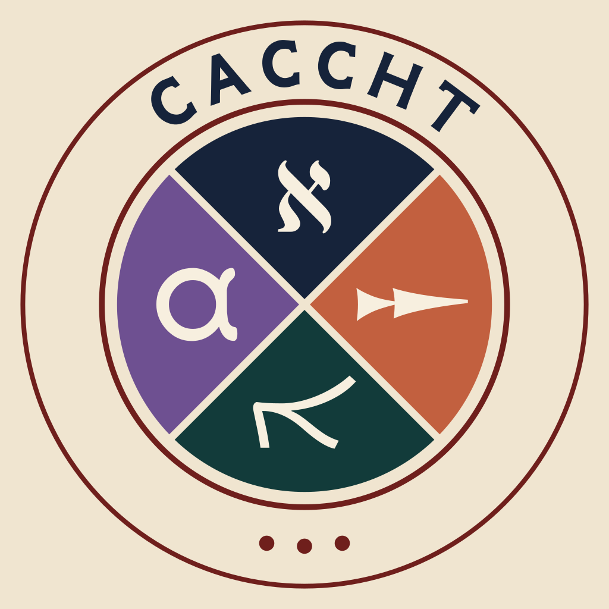

# Copenhagen Ugaritic Corpus

This repo contains a text fabric dataset of the Ugaritic text corpus. It is work in progress.

### The CACCHT project: Creating Annotated Corpora of Classical Hebrew Texts
This dataset is developed as part of the [CACCHT project](https://github.com/CACCHT), which is a collaboration of Christian Canu Højgaard, Martijn Naaijer, Martin Ehrensvärd, Robert Rezetko, Oliver Glanz, and Willem van Peursen. The goal of CACCHT is to prepare and publish ancient Semitic texts digitally, that can be used for research.

For this dataset, we cooperate with Tania Notarius (University of the Free State), Alex Sosnovshchenko and Kseniia Yerofeieva.
Other contributors are Maria Simion, Lynn Strietzel, Ben Shields and Elijah Labowe-Stoll, volunteer assistants (Polis - the Jerusalem Institute of Language and Humanities).

### Data
Version **0.3.0** contains 342 independent KTU texts and three catalogue aliases,
including 63 tablets newly available since 0.2.8. The additions include Ugaritic,
Hurrian, a mixed Ugaritic/Hurrian text, alphabet exercises, and an unclassified
fragment. RIH tablets are not included. Only completed reviews replace the
reference texts; unfinished reviews are excluded.

The [0.3.0 release description](docs/release-0.3.0.md) lists every added tablet
with its language and line count, explains every node, edge and feature, and
reports changes within the previously published tablets.

The textual hierarchy remains `tablet > column > line`, with `word` nodes over
`sign` slots. New `boundary` nodes retain breaks and scribal rulings, and `alias`
nodes resolve catalogue redirects without duplicating their target text.
Invisible synthetic slots retain otherwise empty textual entities.

For queries, use `line_label` for a line's printed address, `surface` and
`surface_cert` for surface attribution, `type` to distinguish letters and lexical
words from gaps, numbers and editorial content, and `emen`, `cert`, `alt` and
`cont` for text-critical information. `g_cons` is a consonantal word reading;
`sign/after` and `usign/uafter` reconstruct the two text formats. The former
constant `language=Ugaritic` feature is retired because it mislabels Hurrian and
mixed-language texts.

Older TF versions remain available. Node numbers are version-specific; use
tablet, column and line addresses when comparing releases.
