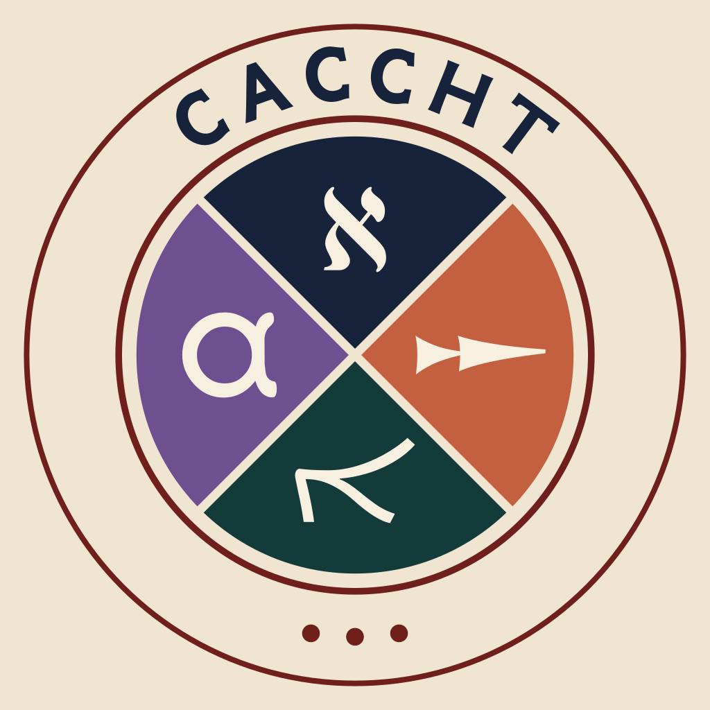

# Copenhagen Ugaritic Corpus

This repo contains a text fabric dataset of the Ugaritic text corpus. It is work in progress.

### The CACCHT project: Creating Annotated Corpora of Classical Hebrew Texts
This dataset is developed as part of the [CACCHT project](https://github.com/CACCHT), which is a collaboration of Christian Canu Højgaard, Martijn Naaijer, Martin Ehrensvärd, Robert Rezetko, Oliver Glanz, and Willem van Peursen. The goal of CACCHT is to prepare and publish ancient Semitic texts digitally, that can be used for research.

For this dataset, we cooperate with Tania Notarius (University of the Free State), Alex Sosnovshchenko and Kseniia Yerofeieva.
Other contributors are Maria Simion, Lynn Strietzel, Ben Shields and Elijah Labowe-Stoll, volunteer assistants (Polis - the Jerusalem Institute of Language and Humanities).

### Data
Version **0.4.0** contains 453 texts: 363 KTU tablets and, for the first time,
90 Ras Ibn Hani texts from RIH II, plus three catalogue aliases. It adds 111
texts to 0.3.0: 21 KTU tablets whose reviews were finished since (KTU 1.32,
1.33 and 4.42–4.62) and the 90 RIH texts that convert without special
handling. KTU 1.4 and 1.31 now use their finished reviews; the other 340
tablets of 0.3.0 are unchanged. Only completed reviews replace the reference
texts; unfinished reviews are excluded.

The [0.4.0 release description](docs/release-0.4.0.md) lists every added text
with its language and line count, every text left out and why, the new
features that come with the RIH texts, and the changes in KTU 1.4 and 1.31.
The [0.3.0 release description](docs/release-0.3.0.md) explains every node,
edge and feature of the current data model.

The textual hierarchy remains `tablet > column > line`, with `word` nodes over
`sign` slots. New `boundary` nodes retain breaks and scribal rulings, and `alias`
nodes resolve catalogue redirects without duplicating their target text.
Invisible synthetic slots retain otherwise empty textual entities.

For queries, use `line_label` for a line's printed address, `surface` and
`surface_cert` for surface attribution, `type` to distinguish letters and lexical
words from gaps, numbers and editorial content, and `emen`, `cert`, `alt` and
`cont` for text-critical information. `g_cons` is a consonantal word reading;
`sign/after` and `usign/uafter` reconstruct the two text formats. `language`
gives the language KTU³ states for the text at each word (`Ugaritic`,
`Hurrian` or `Akkadian`), per tablet or line range; in 0.2.8 it was the
constant `Ugaritic`. Words of a passage KTU³ calls "Hurrian and Ugaritic"
without dividing it have no value yet; the editors will label them.
`tablet_language` gives KTU³'s statement for the whole tablet, including
mixed values such as `Hurrian and Ugaritic`.
RIH texts carry their RIH II citation in `rih`, their KTU number (where they
have one) in `ktu`, and `source_edition=RIH II`; their `tablet` is the KTU
number or else the RIH citation. They have no `language` or `tablet_language`,
because KTU³'s statements do not cover them. `surface_source` keeps RIH II's
French surface headings.

Older TF versions remain available. Node numbers are version-specific; use
tablet, column and line addresses when comparing releases.
